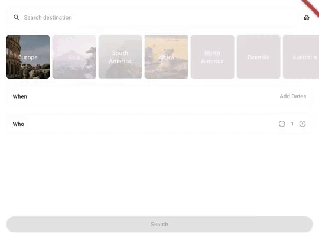

# bombadil_flutter

Third-party Flutter driver for [Bombadil](https://github.com/antithesishq/bombadil).
Fuzz apps through their semantics trees using Flutter's headless engine.



Ten seconds of real fuzzing in Compass.

Requires x86_64 Linux, Nix, and a Bombadil build with `external` support.

```sh
nix develop -c experiments/compass_app/setup.sh
bombadil external fuzz \
  --specification experiments/compass_app/spec.ts \
  --time-limit-fuzz 30s -- experiments/compass_app/driver.sh
```

For your own app, use `runBombadil(app.main)`.
See the [entrypoint](experiments/compass_app/bombadil_main.dart) and [specification](spec/generic.spec.ts).
